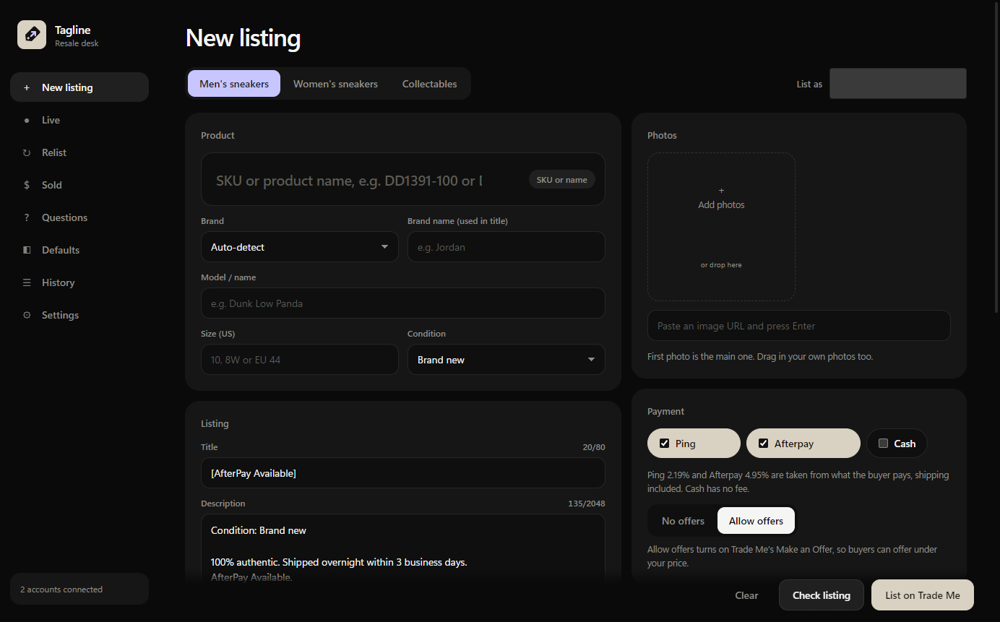
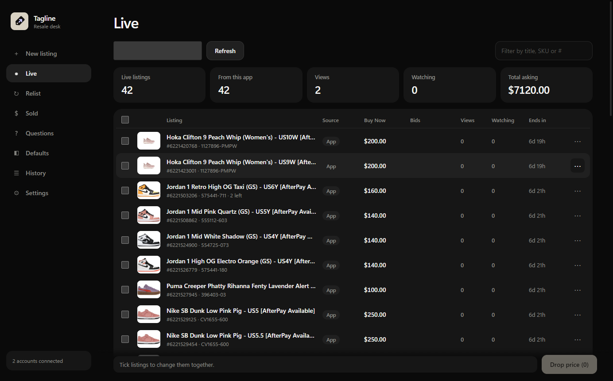
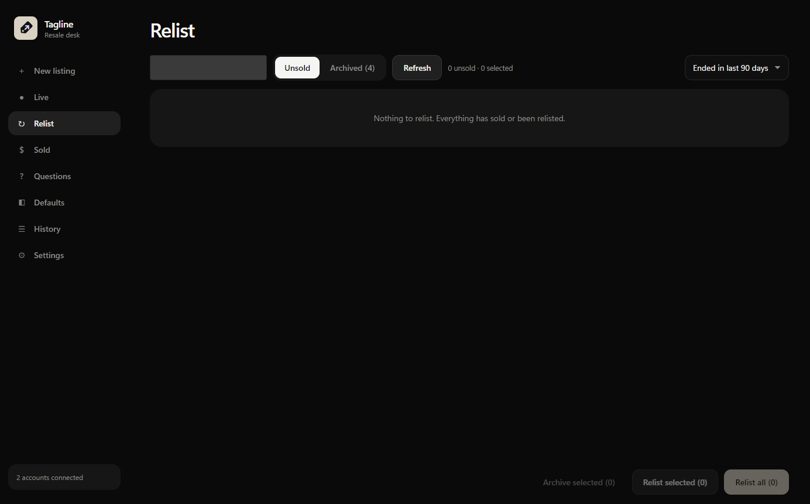
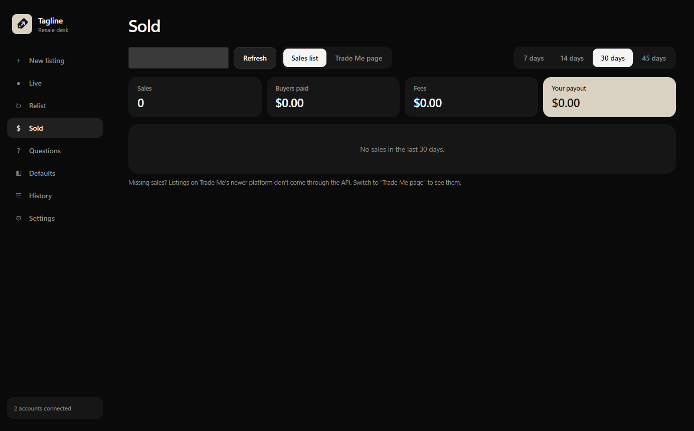
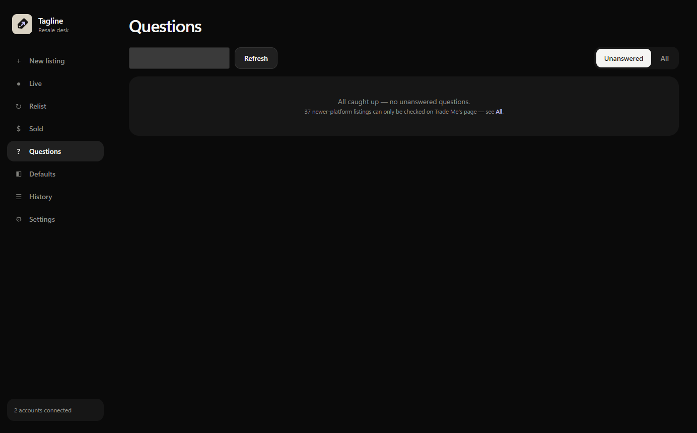
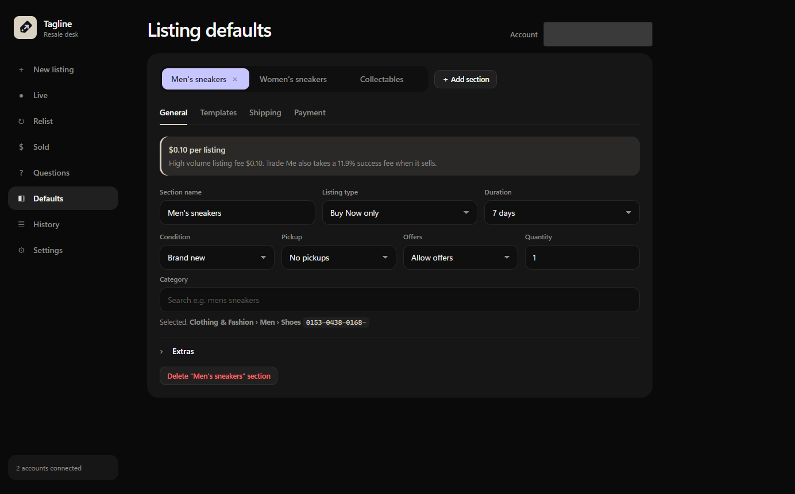
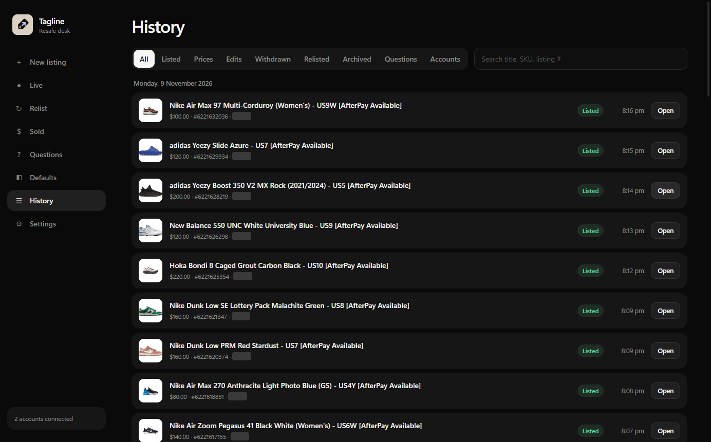
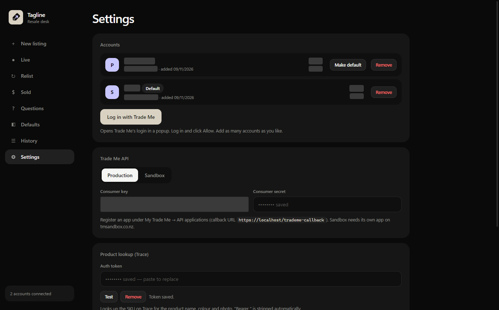

# Tagline

Desktop app for listing on Trade Me fast. Set up a section for each kind of thing you sell, with its
own category, templates, shipping and payment, then list in seconds. Manage everything after that from
one place: live listings (edit, withdraw, bulk price edits, views and watchers), relists, sales, buyer
questions and a full history. Optional product lookup by SKU, size conversion and price comparisons
help when you sell branded stock such as sneakers.

Your Trade Me API keys, accounts and tokens are stored on your own computer only, never in this repo.

## Screens

| | |
|---|---|
| **New listing**: pick a section, fill in the item, see fees and your payout, list.<br> | **Live**: everything for sale, with views, watchers, edits and bulk price changes.<br> |
| **Relist**: unsold listings to relist in one go, or archive.<br> | **Sold**: what sold, fees and your payout.<br> |
| **Questions**: answer buyer questions without leaving the app.<br> | **Defaults**: per-section category, templates, shipping and payment.<br> |
| **History**: every listing, price change, withdrawal, relist and more.<br> | **Settings**: accounts, API keys, product lookup and updates.<br> |

---

## Install on Windows

1. Go to [Releases](https://github.com/FootlockerNZ/tagline/releases/latest) and download
   `Tagline-Setup-x.y.z.exe`.
2. Run it. Windows may show **"Windows protected your PC"** because the app is not code-signed:
   click **More info → Run anyway**.
3. Tagline installs and opens. It is in the Start menu from then on.

**Updates:** open **Settings → Updates → Check for updates**, then **Download** and **Restart to install**.

## Install on Mac

1. Go to [Releases](https://github.com/FootlockerNZ/tagline/releases/latest) and download the right `.dmg`:
   - `Tagline-x.y.z-arm64.dmg` for Apple silicon (M1, M2, M3, M4)
   - `Tagline-x.y.z-x64.dmg` for Intel Macs

   Not sure which one? Click  → **About This Mac**. "Chip: Apple M…" means arm64.
2. Open the `.dmg` and drag **Tagline** into **Applications**.
3. The app is not signed by Apple, so the first time you open it:
   - In **Applications**, right-click **Tagline → Open**, then click **Open** again.
   - If macOS says the app "is damaged" or still won't open, run this once in Terminal:

     ```bash
     xattr -cr /Applications/Tagline.app
     ```

**Updates:** **Settings → Updates** tells you when a new version is out. Download the new `.dmg` and
drag it into Applications to replace the old app. Your settings are kept.

---

## First-time setup (both platforms)

1. **Trade Me API keys.** Get a consumer key and secret (see [Applying for a Trade Me API key](#applying-for-a-trade-me-api-key)
   below) and paste them into **Settings → Trade Me API** in Tagline.
2. **Add your Trade Me account(s).** In **Settings → Accounts**, click **Log in with Trade Me**, sign in and click **Allow**.
   You can add more than one and choose a default.
3. **Set up your sections.** Under **Defaults**, make a section for each kind of thing you sell
   (rename, delete or add your own; the starter ones are just examples). Each section has its own
   category, listing type, shipping, payment and **title/description templates**. The templates start
   empty: fill them in with your own wording and placeholders like `{brand}`, `{name}`, `{condition}`,
   `{sku}` and `{size}`. Click **Preview** to see what a listing would look like.
4. *(Optional)* **Product lookup with Trace.** If you sell branded stock with style codes (e.g. sneakers),
   connect Trace so typing a SKU fills in the product name, colour and photo. See
   [Connecting Trace](#connecting-trace-optional) below.

That's it: pick a section, fill in the item and price, and list.

---

## Connecting Trace (optional)

[Trace](https://jointrace.co) is inventory software for sneaker stores. If you have a Trace account,
Tagline can use it to look up products: type a SKU like `DD1391-100` and it fills in the name, colour
and photo for you. You don't need Trace to use Tagline; without it you type those yourself.

**Easiest way: log in (recommended)**

1. In Tagline, go to **Settings** and scroll down to **Product lookup (Trace)**.
2. Click **Log in to Trace**.
3. If your store logs in to Trace at its own address (e.g. `consign.yourstore.com`), put that in **Trace website**; otherwise leave it blank. Then type the **email and password you use to log in to Trace**, and click **Log in**.
4. You should see "Logged in as you@example.com". Click **Test**: it should say "Working — N results".

That's it. Trace logins expire every so often; Tagline logs back in by itself with your saved details,
so you never have to do this again. Your email and password are saved **encrypted on your computer
only**. To change them, click **Change login** (the email is filled in for you; leave the password
blank to keep the saved one). **Log out** removes them.

**Other way: paste a token (advanced)**

Only use this if logging in doesn't work for your account. A pasted token stops working when it
expires (often within a day), and you'll need to paste a new one.

1. Open your Trace dashboard in **Google Chrome** and log in.
2. Press **F12** (Mac: **Cmd + Option + I**) to open Developer Tools, then click the **Network** tab.
3. Refresh the page (**F5**, Mac: **Cmd + R**).
4. In the filter box at the top of the Network tab, type `onrender`. Click any request in the list.
5. On the right, under **Headers → Request Headers**, find **Authorization**. It looks like
   `Bearer abc123…`. Copy everything after `Bearer `.
6. In Tagline, open **Settings → Product lookup (Trace) → Paste a token instead**, paste it, and
   click **Test**.

Treat that token like a password: anyone who has it can use your Trace account until it expires.

---

## Applying for a Trade Me API key

Tagline talks to Trade Me through your own registered API application. Each business needs its own.

> **Who can apply:** since 10 April 2026 Trade Me only approves Marketplace API applications for
> **in-trade sellers**. Make sure your Trade Me account is set up as an in-trade seller first.

1. Log in to [trademe.co.nz](https://www.trademe.co.nz) with the account that should own the app.
   Apps can't be moved to another member later, so use the business account, not a personal one.
2. Open [Register a new application](https://www.trademe.co.nz/MyTradeMe/Api/RegisterNewApplication.aspx),
   or go to **My Trade Me → Settings → API Applications**.
3. Fill in the form:
   - **Application name / description:** e.g. "Tagline – listing tool for our store". Say it's for
     listing and managing your own stock.
   - **Callback URL:** `https://localhost/trademe-callback`
   - **Permissions:** Read and Write (needed to create, edit and withdraw listings).
   - **Contact email:** a business or shared inbox. Trade Me uses it for outage and API change notices.
4. Submit. Copy the **Consumer key** and **Consumer secret** shown and keep them somewhere safe.
5. **Wait for approval.** Live-site apps are reviewed by Trade Me against their
   [use cases](https://developer.trademe.co.nz/api-overview/use-cases) and
   [terms](https://developer.trademe.co.nz/terms-and-conditions). Until it's approved, logging in from
   Tagline won't work.
6. Once approved, paste the key and secret into **Settings → Trade Me API** in Tagline, then log in
   your account(s) under **Settings → Accounts**.

**Testing first (optional):** the [Trade Me Sandbox](https://www.tmsandbox.co.nz) is a separate test
site with its own membership. Sandbox apps are approved instantly:
[register one here](https://www.tmsandbox.co.nz/MyTradeMe/Api/RegisterNewApplication.aspx) and switch
Tagline to Sandbox in Settings. Listings there aren't real.

Never share your consumer secret or commit it anywhere. Tagline stores it encrypted on your computer only.

---

## For developers

*Only needed if you are changing Tagline's code. To just use the app, follow the install and setup steps above.*

### Run from source

Needs [Node.js](https://nodejs.org) 20 or later.

```bash
npm install
npm start
```

### Release a new version

1. Bump `version` in `package.json` and commit.
2. Tag and push: `git tag v1.1.0 && git push origin main v1.1.0`.
3. GitHub Actions builds Windows and Mac and attaches them to the release. Installed apps pick it up
   from Settings → Updates.
